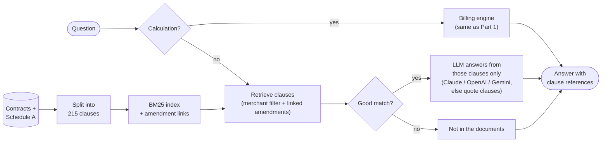

# Contract assistant — RAG architecture

1. **Index:** the contracts are split into one chunk per citable clause (e.g. `M01-§4.2`, `A.4`, `M09-Ann1.1`); each amendment is linked to the clause it changes.
2. **Route:** questions that need a number (e.g. a COD fee on ₹3,000) go to the billing engine, so numbers never come from the LLM.
3. **Retrieve:** keyword (BM25) search over the clauses of the merchant named, plus Schedule A; amendments come along with the clause they amend.
4. **Answer:** if nothing matches well, it says the documents don't contain the answer. Otherwise the LLM answers only from the retrieved clauses and cites them; without an API key it quotes the clauses instead.

Detailed diagrams: [`src/assistant/README.md`](src/assistant/README.md#architecture).
