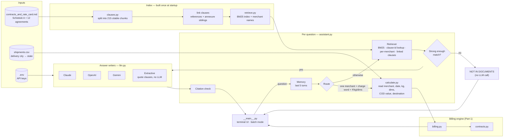
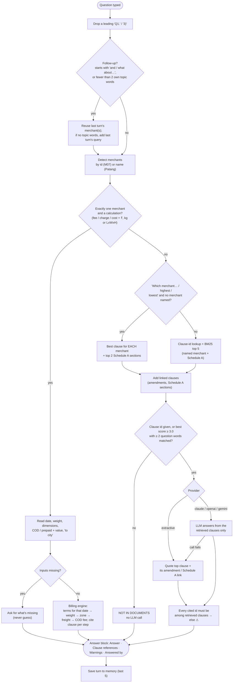
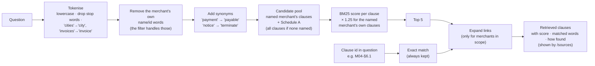
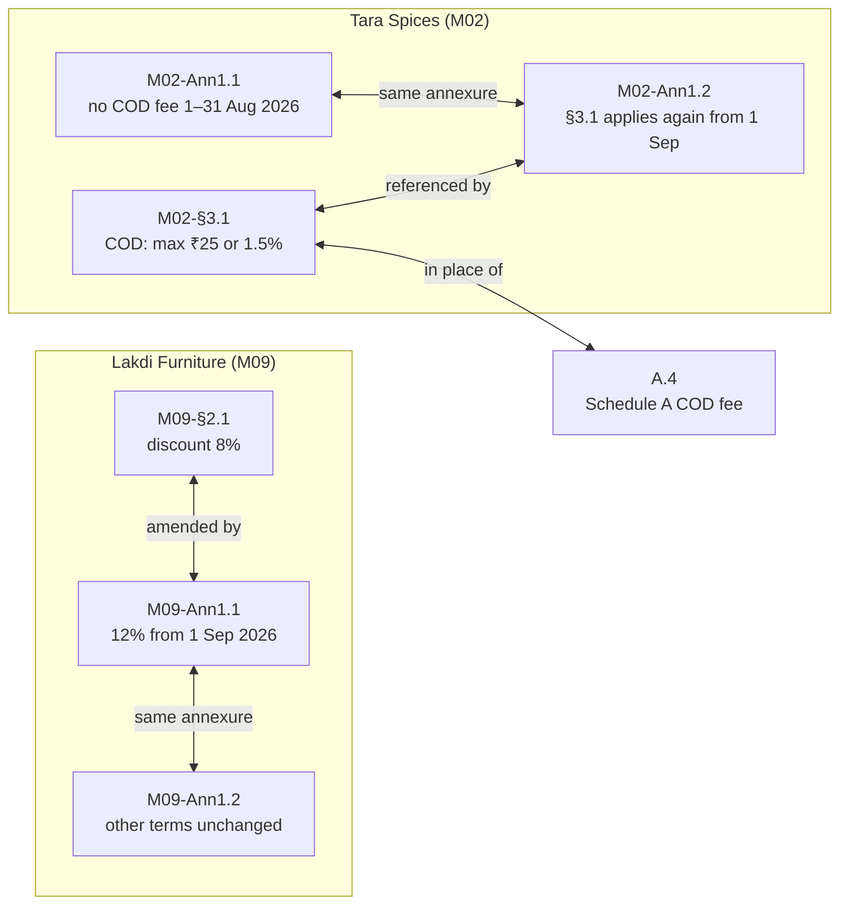
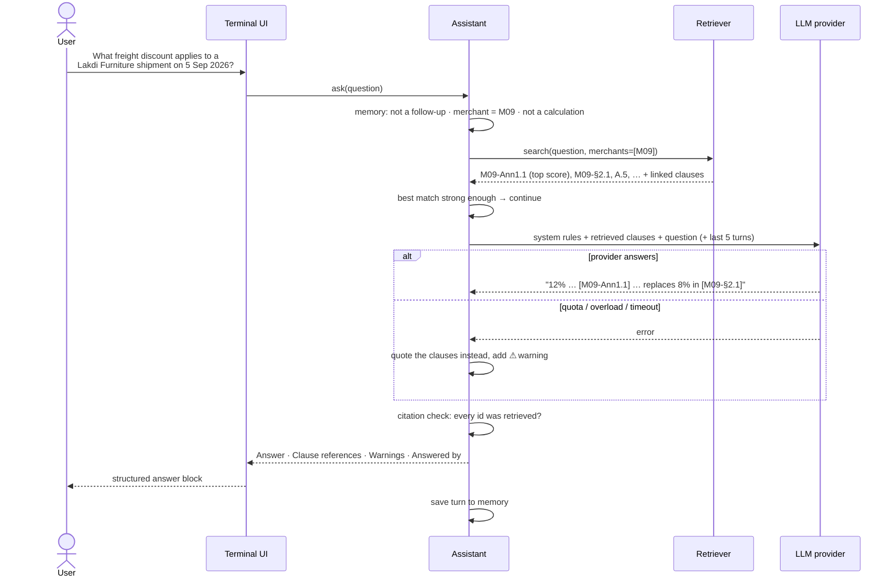
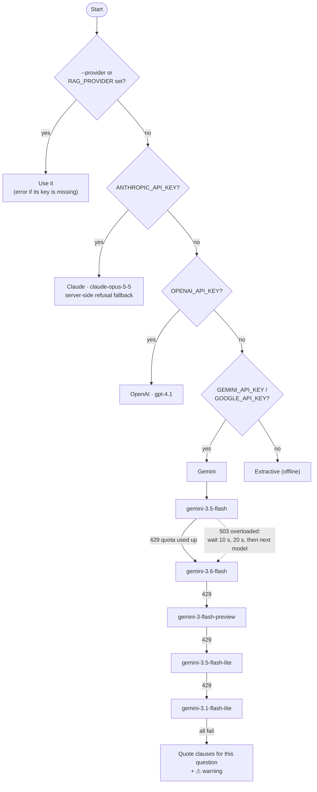

# Contract assistant (Part 3)

A terminal assistant that answers questions about the 12 merchant agreements and Schedule A
(`data/contracts_and_rate_card.md`). Every answer cites the clause it comes from (e.g. `M01-§4.2`),
and when the documents don't contain the answer it says so plainly instead of guessing.

## Quick start

```bash
source .venv/bin/activate
pip install -r requirements.txt          # includes anthropic, openai, google-genai

# 1. Add an API key (any one) to .env in the repo root -- it is git-ignored
#    GEMINI_API_KEY=your-key-here
#    (see .env.example; a real environment variable also works and takes priority)

# 2. Start the assistant
python -m src.assistant
```

No key? It still works: it runs in **extractive** mode and quotes the matching clauses verbatim.

## Using it

```
$ python -m src.assistant
Shadowfax contract assistant — 215 clauses from Schedule A + 12 agreements
Provider: extractive (model: none (quotes clauses)) | API keys found: gemini
Ask a question, or /help. Memory: last 5 turns.

you> 
────────────────────────────────────────────────────────────────────────────────────────────────
Q: What COD fee applies to a Vaidya Wellness COD shipment worth ₹3,000?
────────────────────────────────────────────────────────────────────────────────────────────────
Answer
  No booking date given; M08 has no dated amendments, so the date doesn't change the answer.
  COD fee: higher of ₹35 or 2.50% × ₹3,000.00 (= ₹75.00) → ₹75.00 [M08-§3.1]. Discounts never
  apply to the COD fee [A.5].
  (Computed with the billing engine from the contract terms.)

Clause references
  [M08-§3.1]  Vaidya Wellness (M08) · Cash on delivery
  [A.5]       Schedule A · Discounts

Answered by: billing engine (src/billing.py), no LLM · calculation
────────────────────────────────────────────────────────────────────────────────────────────────

you> 
────────────────────────────────────────────────────────────────────────────────────────────────
Q: What is Shadowfax's PAN?
────────────────────────────────────────────────────────────────────────────────────────────────
Answer
  NOT IN DOCUMENTS: the contracts and Schedule A don't contain this. Closest clause: M01
  preamble (weak match).

Answered by: retrieval only — no clause matched well enough, no LLM called · not found
────────────────────────────────────────────────────────────────────────────────────────────────

you> bye
```

Each answer is one block: the question, **Answer** (clause ids in brackets), **Clause references** (each cited clause with its merchant and section), any **Warnings**, and **Answered by** (provider and the model that actually answered, or the billing engine). Above is offline mode; with an API key, retrieval answers are written as sentences by the LLM. Calculations and "not in documents" answers don't use the LLM, so they look the same either way. A leading `Q1.` typed before a question is ignored.

| Command | What it does |
|---|---|
| `/help` | list commands |
| `/sources` | clauses retrieved for the last answer, with BM25 scores and matched words |
| `/history` | the questions currently in memory |
| `/clear` | forget the conversation |
| `/provider [name]` | show or switch provider: `claude`, `openai`, `gemini`, `extractive` |
| `/exit`, `/quit`, Ctrl-D | leave |

**Batch mode** (one question per line, each answered on its own):

```bash
python -m src.assistant --questions questions.txt            # writes outputs/contract_answers.md
python -m src.assistant --questions questions.txt --provider gemini --out outputs/answers_gemini.md
```

## Architecture

GitHub (and VS Code with a Mermaid extension) renders the diagrams below.

### 1. Components



### 2. Question flow



### 3. Retrieval



### 4. Amendments travel with the clause they change

Links are found by scanning each clause for clause ids and "section A.x", in both directions, and clauses of
the same annexure are linked to each other. Retrieving any one of them brings the rest.



In calculations the dates are applied in code (`contracts.py` amendments with start/end dates), not by the LLM.

### 5. One question, end to end (LLM mode)



### 6. Choosing a provider, and Gemini's model fallback



Each Gemini call has a 30 s timeout and the SDK's own retries are off, so a call never hangs. A key that exists but
has no credits still counts as available (see Limitations).

## How it's built

### Pieces

| File | Role |
|---|---|
| `clauses.py` | Splits the markdown into 215 citable chunks: Schedule A sections (`A.1`–`A.5`), agreement preambles (`M01 preamble`), numbered clauses (`M01-§4.2`), annexures (`M09-Ann1.1`). Links clauses that refer to each other, and annexure clauses to each other. |
| `retrieve.py` | BM25 keyword ranking, merchant detection (by id or name), a small synonym list (e.g. "payment terms" → "payable"), a 1.25× boost for the named merchant's own clauses (they override Schedule A), exact clause-id lookup, linked-clause expansion. |
| `calculate.py` | Reads merchant, date, weight, dimensions, payment mode, COD value and destination from the question; computes with the billing engine; cites the clause for each step; asks for anything missing. |
| `llm.py` | Provider selection, the system prompt, and the Claude / OpenAI / Gemini calls. Loads `.env`. |
| `assistant.py` | The flow above, plus 5-turn memory and citation checking. |
| `__main__.py` | Terminal UI and batch mode. |

### Design choices

- **Clause-level chunks.** The unit of retrieval is the unit of citation, so every answer can point to an exact clause id.
- **BM25, not embeddings.** The contracts are short and use consistent wording; keyword ranking is fast, needs no model download, and `/sources` shows exactly why a clause ranked first.
- **Amendments travel with the clause they change.** Asking about M09's discount always brings `M09-Ann1.1` (12% from 1 Sep 2026) alongside `M09-§2.1` (8%), so the date-dependent answer is never missed.
- **Numbers come from code, not the LLM.** Calculation questions bypass the LLM and use the same billing engine as the Part 1 audit (the same engine 56 unit tests cover).
- **Saying "not in the documents".** Two layers: if the best clause scores below 3.0 (BM25) or matches fewer than 2 question words, the assistant answers `NOT IN DOCUMENTS` without calling an LLM; otherwise the LLM is instructed to reply `NOT IN DOCUMENTS: ...` when the provided clauses don't answer the question.
- **Citation check.** Any clause id the LLM cites that wasn't retrieved is flagged with a ⚠ line under the answer.

## Two modes: LLM and extractive

| Mode | When | What you get |
|---|---|---|
| **LLM** | an API key is found (or `--provider claude/openai/gemini`) | The LLM writes a short answer from the retrieved clauses only, citing clause ids. |
| **Extractive** | no API key, or forced with `--provider extractive` / `RAG_PROVIDER=extractive` / `/provider extractive` | No LLM: the best-matching clause is quoted verbatim, plus any amendment or Schedule A section linked to it. Works fully offline. |

**Automatic fallback:** in LLM mode, if the call fails for any reason (quota, billing, overload, network, timeout),
that question is still answered in extractive mode, with a ⚠ warning saying why.

In both modes, calculation questions go to the billing engine and weak matches get `NOT IN DOCUMENTS` without an LLM,
so those answers are identical either way.

## Providers and configuration

The first provider with a key wins: **Claude → OpenAI → Gemini → extractive**. Override with `--provider` or `RAG_PROVIDER`.

| Provider | Key (env var or `.env`) | Default model | Override |
|---|---|---|---|
| Claude | `ANTHROPIC_API_KEY` | `claude-opus-5-5` | `RAG_CLAUDE_MODEL` |
| OpenAI | `OPENAI_API_KEY` | `gpt-4.1` | `RAG_OPENAI_MODEL` |
| Gemini | `GEMINI_API_KEY` or `GOOGLE_API_KEY` | `gemini-3.5-flash` | `RAG_GEMINI_MODEL` |
| Extractive | — | quotes clauses | — |

- **Gemini free tier:** each model has its own quota. If the main model's quota is used up (429) the assistant moves straight to the next model (`gemini-3.6-flash` → `gemini-3-flash-preview` → `gemini-3.5-flash-lite` → `gemini-3.1-flash-lite`; override with a comma-separated `RAG_GEMINI_FALLBACK_MODELS`). If a model is overloaded (503) it waits 10 s, then 20 s, before moving on. Each call times out after 30 s. If every model fails, the answer falls back to quoting the clauses, with a ⚠ warning.
- **Claude:** requests use server-side refusal fallback (`fallbacks: "default"`), so a safety refusal is retried on a fallback model automatically.
- Temperature 0 (OpenAI/Gemini) for repeatable answers.

## Tests

```bash
pytest tests/test_assistant.py -q
```

Offline tests (the LLM is stubbed): clause parsing, amendment links, merchant detection, ranking, clause-id lookup,
"not in documents", follow-up memory, the 5-turn limit, calculations (M02 waiver boundaries, M09 September discount,
missing inputs) and the unretrieved-citation warning.

## Limitations

- Calculation parsing uses simple patterns: give a merchant, date, weight (`1.2 kg`), dimensions (`30x20x10`),
  `COD ₹2,000` or `prepaid`, and `to <city>`. Missing inputs are asked for, not guessed.
- Delivery-city states come from the cities in `shipments.csv` plus the pickup cities; other cities need their state.
- **"Available" means a key is set, not that it works.** The first provider with a key is used even if that account
  has no credits or quota. Every question then tries that provider, fails, and drops to extractive; the next provider
  (e.g. Gemini after OpenAI) is not tried. Workaround: set `RAG_PROVIDER=gemini` in `.env`, start with
  `--provider gemini`, or use `/provider gemini`. A possible improvement: on a quota or billing error, try the next
  provider that has a key, and skip the failed one for the rest of the session.
- **Extractive answers are narrow.** They quote the top clause and what links to it. For "which merchant..."
  questions that is one merchant's clause, not all twelve. A possible improvement: show the top two or three clauses
  with their titles, and one clause per merchant for comparison questions (retrieval already finds them; only the
  extractive answer drops them).
- BM25 matches words, not meaning: an unusual paraphrase can miss a clause. `/sources` shows what was retrieved, and
  the synonym list in `retrieve.py` is where to fix it.
